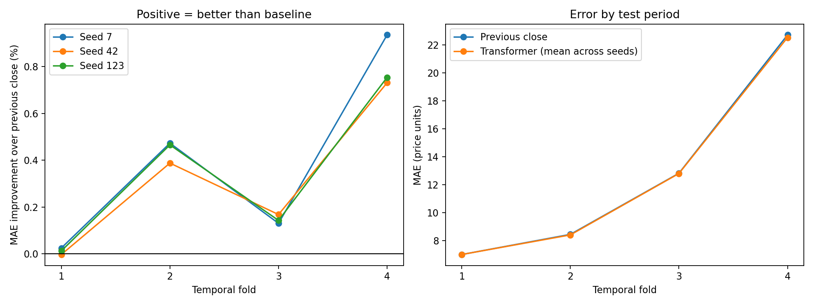

# GOOG Forecasting: Multivariate LSTM and Residual Transformer

[中文版](README.zh-CN.md)

An end-to-end time-series model diagnosis and evaluation case study using 4,006 historical GOOG trading observations. Two executable tasks are included: a multivariate Keras LSTM using 90 trading observations to predict the close exactly 60 trading observations ahead, and a PyTorch residual Transformer using 60 closes to predict the next observation.

The main result is a reproducible evaluation: a residual Transformer performs close to a previous-close baseline across four time periods and three random seeds. After diagnosing systematic underprediction in a direct-price model, the revised architecture reduced that error substantially, but the multi-period comparison found only a small advantage over persistence.

**Stack:** Python, TensorFlow/Keras, PyTorch, pandas, NumPy, scikit-learn, Matplotlib, unittest.

## Results at a glance

| Expanding-window evaluation | Residual Transformer (range across 3 seeds) | Previous-close baseline |
| --- | ---: | ---: |
| MAE | 10.9011–10.9077 | 10.9425 |
| RMSE | 17.4827–17.4858 | 17.5010 |

The evaluation covers 1,354 distinct trading dates across four non-overlapping test periods. MAE improves in 11 of 12 fold/seed runs, but the overall improvement is only 0.32%–0.38%. The runs share data and are not independent statistical trials. Historical test feedback informed the model revision, so these are development and stability results, not untouched final-test evidence.



See [per-run metrics](reports/walk_forward/fold_metrics.csv), [aggregate metrics](reports/walk_forward/aggregate_metrics.csv), and the [technical review](docs/model-review.md).

[技术分析中文版](docs/model-review.zh-CN.md)

## Quick start: evaluated Transformer

Run from the repository root. The completed runs used Python 3.12 on macOS ARM64 with CPU execution.

```bash
python -m venv .venv
source .venv/bin/activate
python -m pip install -r requirements.txt
python -m unittest discover -s tests -v
python src/transformer_stock_price_prediction_original.py --input data/GOOG.csv --output-dir reports/reproduced
python src/walk_forward.py --input data/GOOG.csv --output-dir reports/walk_forward_reproduced
```

The two output directories keep the included experiment artifacts available for comparison. The walk-forward command trains 12 models, so it takes longer than the single split. `requirements.txt` records the direct package versions used for the completed runs; it is not a full transitive lockfile, and exact numerical results can vary across platforms.

## Scope

The legacy notebook and weights remain outside the active project. A new executable LSTM pipeline implements the architecture and task described in the interview document, with corrected chronological evaluation. The Transformer evaluation remains available as a separate next-day experiment. Their errors are not directly comparable because their horizons and inputs differ.

## Multivariate LSTM implementation

Use an isolated environment; the completed LSTM experiment uses `.venv-lstm` rather than the existing Anaconda environment.

```bash
python -m venv .venv-lstm
source .venv-lstm/bin/activate
python -m pip install -r requirements-lstm.txt
python -m unittest discover -s tests -p 'test_lstm_windows.py' -v
python src/lstm_stock_price_prediction.py --input data/GOOG.csv --output-dir reports/lstm_reproduced
```

Five inputs (`Open`, `High`, `Low`, `Close`, `Adj Close`) use train-only `StandardScaler`; the Close target has its own train-only scaler for inverse transformation. The network is LSTM(64, return_sequences=True), Dropout(0.2), LSTM(10), Dropout(0.2), Dense(1). It predicts only the 60th future trading observation, not all 60 future prices. Architecture and window sizes reproduce the document's choices; they are not claimed to be optimal.

Training uses Adam, MSE, `EarlyStopping` (patience 10), `ReduceLROnPlateau` (patience 5, factor 0.5), and `ModelCheckpoint`. The maximum is 100 epochs; the actual stopping epoch and validation MSE are measured rather than forced to the document's historical values.

The chronological row boundaries are 70/15/15. Each sample's last input is exactly 60 observations before its target. The first 59 validation and test targets are excluded so that all labels used in model training/checkpoint selection are known at each later forecast origin. This produces 2,655 training, 542 validation, and 542 test samples. Overlapping windows do not create new independent observations.

`reports/lstm/` contains the completed experiment results; `best_model.keras` remains local. Included files are `scalers.npz`, `training_history.csv`, `run_metadata.json`, validation/test prediction tables, `metrics.csv`, and `test_forecast.png`. Metrics include standardized MSE and price-space MAE/RMSE, alongside a persistence forecast using the last close available at the forecast origin (60 observations before the target). The PDF's historical MSE of 0.14366 is not a target or a reproduced result.

Actual seed-42 run: training stopped after 11 epochs, with the best checkpoint at epoch 1. Best validation standardized MSE was 4.672148. On 542 test targets, LSTM MAE/RMSE were 646.3543/659.0420, versus 124.1356/144.6645 for horizon-matched persistence. The LSTM severely underpredicts the later price regime and fails to beat its baseline. This reconstructs the documented method, not its claimed historical performance.

The project is presented as a reproducibility and model-review case study. The emphasis is on time-series data preparation, sequence construction, architecture choices, and evaluation hygiene—not on investment advice or trading recommendations.

## Dataset

`data/GOOG.csv` contains 4,006 daily observations (4,007 CSV lines including the header) with:

`Date`, `Open`, `High`, `Low`, `Close`, `Adj Close`, `Volume`

The data spans 2004-08-19 to 2020-07-17. The owner-supplied raw CSV remains local while its provider and redistribution terms are unverified. Obtain compatible data separately before running the scripts.

## Repository structure

```text
.
├── data/GOOG.csv
├── src/transformer_stock_price_prediction_original.py  # Single split; residual or absolute
├── src/walk_forward.py                              # Expanding-window evaluation
├── src/lstm_stock_price_prediction.py               # Multivariate 90-to-60 LSTM
├── tests/test_forecasting.py                        # Alignment and model behavior
├── tests/test_lstm_windows.py                       # Horizon and forecast-origin checks
├── reports/walk_forward/                            # 12 completed runs and summaries
├── reports/absolute_original/                       # Archived direct-price result
├── docs/model-review.md
├── requirements.txt
├── requirements-lstm.txt
└── README.md
```

## Key review findings

1. The new LSTM script reconstructs the interview document's 90-observation lookback and scalar 60-step target, with temporal safeguards and actual measured results.
2. The historical Transformer prototype leaked future information through full-dataset scaling and plotted training predictions. These issues have been repaired in the executable script.
3. The executable version uses an encoder-only model, chronological splits, train-only scaling, validation checkpoint selection, and held-out MAE/RMSE against the previous-close baseline.
4. Direct price-level prediction substantially underestimated the later, higher-price test period. The default residual model centers each window on its last close and predicts a change added to that close.
5. The current result is approximately baseline performance; it does not establish a useful forecasting advantage.

## Reproducible Transformer evaluation

The executable script uses chronological 70/15/15 train/validation/test splits, fits scaling on the training period only, predicts the next trading observation, and compares a Transformer with the previous-close baseline:

```bash
python src/transformer_stock_price_prediction_original.py --input data/GOOG.csv --output-dir reports
```

It writes held-out predictions, MAE/RMSE metrics, and a test plot under `reports/`.

### Latest experiment

With seed 42, a 60-observation window, and 30 epochs, validation selected epoch 17. The 601-observation test period spans 2018-02-28 to 2020-07-17.

| Method | Test MAE | Test RMSE |
| --- | ---: | ---: |
| Direct-price Transformer (prior run) | 313.1386 | 329.7129 |
| Residual Transformer | 15.5973 | 23.3166 |
| Previous close | 15.6358 | 23.3316 |

The residual model improves MAE by only about 0.25% and RMSE by about 0.06% over the baseline. This is a single seed and a single historical holdout, with no significance test. Because the test result informed the architecture revision, the holdout is now a development comparison. The completed walk-forward evaluation below checks historical stability; a fresh untouched temporal holdout would be needed for a stronger generalization claim.

The prior run is preserved under `reports/absolute_original/`. The new run adds `training_history.csv` and `run_metadata.json`. Validation MSE is weighted by observation count, and residual checkpoint selection includes epoch zero (the previous-close predictor).

To reproduce the direct-price architecture with the corrected validation aggregation:

```bash
python src/transformer_stock_price_prediction_original.py --mode absolute --output-dir reports/absolute_rerun
```

Check window alignment and residual behavior with `python -m unittest discover -s tests -v`.

### Expanding-window evaluation

```bash
python src/walk_forward.py --input data/GOOG.csv --output-dir reports/walk_forward
```

The fixed protocol starts with 2,400 training observations, uses the next 252 for validation, and tests on the next 400 (the final fold contains the remaining observations). Training expands by 400 observations each fold. Four test periods are disjoint and cover rows 2,652–4,005 (zero-based), with seeds 42, 7, and 123 and 30 epochs per run. All preprocessing is fitted again on the training prefix; each model is trained from scratch. Checkpoint selection includes epoch zero and uses validation only.

This is rolling one-observation-ahead forecasting: after each test date, its observed close may enter the next input window. Models are not retrained inside a test fold. It is not a forecast of an entire future block made at its start. Prior test observations may be used as training/validation data in a later fold, once they are in the past.

`fold_metrics.csv` reports each fold and seed; `aggregate_metrics.csv` computes MAE and RMSE across all 1,354 test dates separately for each seed. It does not average fold RMSE or count three predictions of a date as independent observations. Per-run logs, histories, configurations, predictions, and charts are retained. `walk_forward_comparison.png` compares fold errors and percentage improvements over persistence.

The architecture was chosen after inspecting the historical holdout. This evaluation is a historical stability check with fixed settings, not a pristine final holdout or evidence of trading profitability.

Completed results (Transformer MAE averaged across the three seeds within each period):

| Test period | Observations | Transformer MAE | Previous-close MAE |
| --- | ---: | ---: | ---: |
| 2015-03-04–2016-09-30 | 400 | 7.0131 | 7.0139 |
| 2016-10-03–2018-05-04 | 400 | 8.4156 | 8.4529 |
| 2018-05-07–2019-12-05 | 400 | 12.8078 | 12.8267 |
| 2019-12-06–2020-07-17 | 154 | 22.5363 | 22.7197 |

Across all dates, per-seed MAE ranges from 10.9011 to 10.9077 versus 10.9425 for persistence (0.32%–0.38% improvement). Per-seed RMSE ranges from 17.4827 to 17.4858 versus 17.5010 (0.087%–0.105% improvement). MAE improves in 11/12 runs and RMSE in 10/12; the first fold is essentially tied. These correlated runs are not independent evidence of statistical significance. No seed was selected based on its test result.

The resulting case study demonstrates reproducible time-series evaluation and a correction for price-level extrapolation failure. The residual Transformer remains near the persistence baseline; a practically meaningful predictive advantage has not been established.

## Responsible interpretation

This project is educational. Historical price prediction is highly non-stationary and the supplied experiments do not establish a deployable trading signal.


Dataset provenance: the owner-supplied GOOG.csv is local only. The original provider and redistribution terms have not been established. Prepare compatible data independently; no dataset license is granted by this repository.
